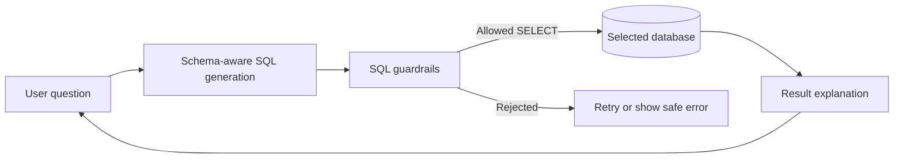

# QueryPilot

**An AI-powered interface for querying databases using natural language.** Connect a database or upload a SQLite file, ask questions in plain English, and get SQL-backed answers with the generated query and result rows. QueryPilot checks generated SQL against safety guardrails before execution and explains results in clear language.

QueryPilot is a portfolio project demonstrating a practical natural-language-to-SQL workflow: local LLM inference, schema-aware SQL generation, query validation, database execution, and a usable interface without requiring a paid LLM API key.

## Features

- Dark Streamlit dashboard with schema browsing, answers, guarded SQL, result tables, and session history.
- Local inference through Ollama; no hosted LLM API is needed for the default setup.
- Included demo sales database, SQLite file upload (`.db`, `.sqlite`, `.sqlite3`, maximum 100 MB), or a database URL.
- SQLite and PostgreSQL database URLs are supported by the UI. PostgreSQL connections need network access and the PostgreSQL driver included with the project.
- SQL validation limits queries to one read-only `SELECT`, restricts access to discovered tables, and applies a row limit.
- Optional FastAPI endpoint for programmatic analysis.
- Docker Compose setup with separate app and Ollama containers and persistent model/demo-data volumes.

## How it works



The Streamlit UI and FastAPI route both call the same `NL2SQLAgent` pipeline. For custom databases, use a database account with read-only permissions as a database-level safeguard. Uploaded SQLite files are opened read-only; PostgreSQL queries use read-only transactions.

## Run locally

Prerequisites: Python 3.12 or newer and [Ollama](https://ollama.com/download). The model download needs internet access once; inference runs locally afterward. Model performance and memory use depend on your hardware.

In PowerShell, from the project folder:

```powershell
ollama pull llama3:latest
py -m venv .venv
.\.venv\Scripts\Activate.ps1
python -m pip install --upgrade pip
pip install -e .
Copy-Item .env.example .env
python scripts/init_demo_db.py
streamlit run app.py
```

Open the local URL printed by Streamlit, usually <http://localhost:8501>. Make sure the Ollama app/service is running. If you already have a `.env`, keep it and skip the copy command.

To run the optional API locally after installing dependencies:

```powershell
uvicorn sql_agent.api.main:app --app-dir src --host 127.0.0.1 --port 8000
```

Send a request to `POST http://127.0.0.1:8000/v1/analyze` with JSON such as `{"question":"What were total payments by region?"}`. In development mode, API key authentication is disabled by default; keep this API bound to localhost.

## Run with Docker Compose

Prerequisites: Docker Desktop running with Linux containers. Compose starts Ollama, downloads the model configured by `OLLAMA_MODEL`, initializes the demo database, and starts the UI. The first build/model download can take several minutes.

```powershell
Copy-Item .env.example .env  # Skip if .env already exists.
docker compose up --build -d
```

Open <http://localhost:8501>. Follow startup with `docker compose logs -f app`; model download output is available with `docker compose logs -f ollama-init`.

To also run the optional API container:

```powershell
docker compose --profile api up --build -d
```

The API is bound to <http://127.0.0.1:8000>. Ollama is reachable by the app over the private Compose network and is not published to the host. Stop containers with `docker compose down`; this preserves model and demo database volumes. `docker compose down -v` deletes those volumes and their data.

The Compose setup overrides `OLLAMA_BASE_URL` to use the Ollama service name. If you connect to a database running on your host machine, use `host.docker.internal` instead of `localhost` in its URL. Uploaded SQLite files are temporary session files and are removed when their connection is replaced; they do not survive replacing the app container.

## Configuration and database connections

`.env.example` documents the local settings. Copy it to `.env` for local runs; `.env` is ignored by Git and excluded from the Docker build context. The default provider is Ollama and needs no API key. Optional OpenAI/Azure credentials belong only in your private `.env` when you intentionally enable those providers.

The UI's **Connections** page supports:

1. The included sample sales database.
2. A SQLite file upload (up to 100 MB).
3. A file-based SQLite or PostgreSQL SQLAlchemy URL.

Connections and question history are held in the current Streamlit browser session. Do not expose this demo publicly or enter production database credentials into an untrusted deployment. The Compose API is configured for local development and is not a production deployment recipe.

## Development

Install development dependencies and run the test suite:

```powershell
pip install -e ".[dev]"
pytest -q
```

The optional `local-llm` extra installs Transformers-based inference dependencies. The default Ollama path does not need that extra.

## Project structure

```text
src/sql_agent/
  api/       FastAPI routes and app lifecycle
  core/      Agent pipeline, LLMs, schema, guardrails, execution, caching
  data/      Demo schema and seed data
  ui/        Streamlit dashboard and connection handling
  compat/    Backward-compatible import modules
scripts/     Demo database initialization
tests/       Guardrail and pipeline tests
docs/        Architecture notes
Dockerfile   App image
docker-compose.yml  App, Ollama, optional API, and persistent volumes
```

## GitHub publishing checklist

- Commit source, documentation, `.env.example`, Dockerfile, and Compose configuration.
- Keep `.env`, database files, caches, virtual environments, and model files out of Git; the ignore files cover these local artifacts.
- Review `git status` and `git diff --cached` before committing. Publish built images separately to a container registry such as GHCR if you want to offer a ready-to-pull image; do not commit image archives to the repository.
- Add a demo video link here after you record one.
