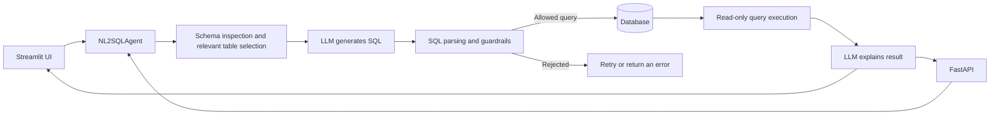

# Architecture

The Streamlit UI and FastAPI endpoint share one natural-language-to-SQL pipeline.

## Package boundaries

- `sql_agent.ui` contains the Streamlit presentation layer and per-session database connections.
- `sql_agent.api` contains HTTP routes, request validation, API-key authentication, and application lifecycle.
- `sql_agent.core` contains the pipeline and reusable services: LLM providers, schema inspection, SQL validation, database execution, caching, and rate limiting.
- `sql_agent.data` contains the demo schema and seed data.
- `sql_agent.config` loads typed settings from environment variables and `.env`.
- `sql_agent.compat` provides backward-compatible import paths.

The `src` layout keeps application code separate from scripts and tests. `pyproject.toml` defines the installable package and optional dependency groups.

The UI and API both call `NL2SQLAgent.analyze`. Provider implementations share an interface, so Ollama or an optional hosted provider can be used without changing the SQL pipeline. Guardrails validate a generated statement against the discovered schema, require a single read-only query, and cap result size. The database should still use a read-only principal because application guardrails are not a replacement for database permissions.

## Docker Compose

Compose runs the app and Ollama in separate services. The app reaches Ollama through the private Compose network. Named volumes persist downloaded models and the demo database. The optional API profile shares the demo database volume with the UI and starts after the UI has initialized it.
